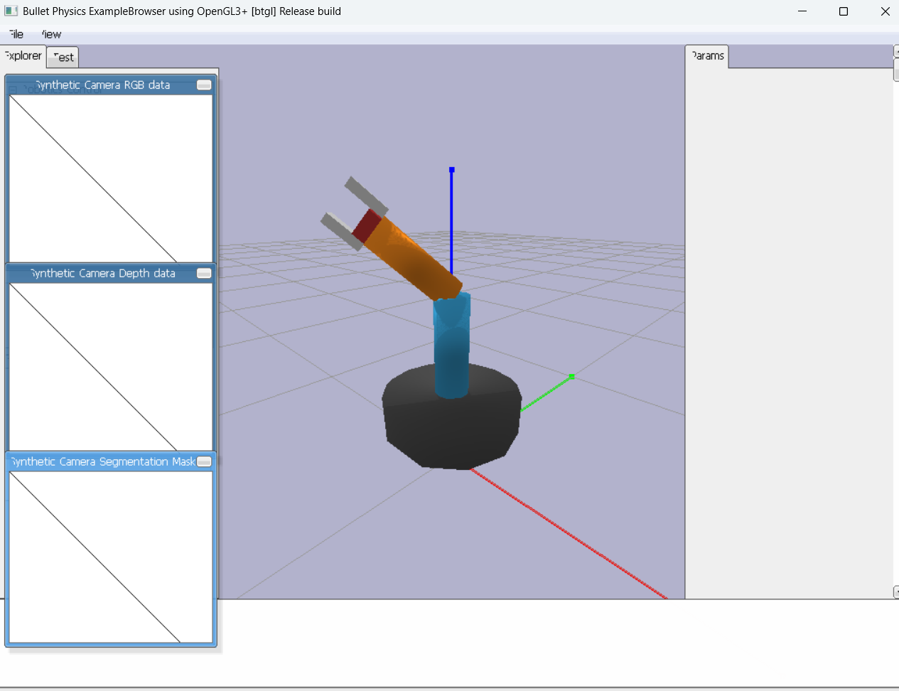

# Control de brazo robótico con PyBullet

Proyecto de simulación y control de un brazo robótico utilizando **Python, PyBullet y un modelo URDF**.

El objetivo de esta primera etapa es controlar el brazo mediante el teclado del computador, antes de realizar la integración con una ESP32 y los servomotores físicos.

## 1. Tecnologías utilizadas

* Python 3.12
* PyBullet
* URDF
* Visual Studio Code

## 2. Estructura del proyecto

```text
ControlURFT_BRAZO/
│
├── brazo.urdf
├── main.py
├── test.py
└── README.md
```

El archivo `brazo.urdf` contiene la descripción del robot y sus articulaciones.

El archivo `main.py` ejecuta la simulación y permite controlar el brazo.

El archivo `test.py` se utilizó para comprobar inicialmente que PyBullet pudiera cargar correctamente el modelo.

## 3. Entorno virtual

El proyecto utiliza un entorno virtual con Python 3.12.

Para activarlo:

```powershell
.\venv\Scripts\Activate.ps1
```

Después se ejecuta el programa mediante:

```powershell
python main.py
```

PyBullet se instala con:

```powershell
pip install pybullet
```

## 4. Carga del modelo

El programa establece una conexión con PyBullet y carga el archivo URDF:

```python
physics_client = p.connect(p.GUI)

robot_id = p.loadURDF(
    "brazo.urdf",
    [0, 0, 0.15],
    useFixedBase=True
)
```

`p.GUI` permite visualizar la simulación gráficamente.

El parámetro `useFixedBase=True` mantiene fija la base del brazo mientras se mueven sus articulaciones.

<!-- INSERTAR IMAGEN AQUÍ -->


## 5. Identificación de las articulaciones

Una vez cargado el robot, PyBullet permite obtener información sobre sus articulaciones:

```python
num_joints = p.getNumJoints(robot_id)

for i in range(num_joints):

    info = p.getJointInfo(robot_id, i)

    joint_name = info[1].decode("utf-8")

    print(i, joint_name)
```

Esto permite conocer el identificador de cada articulación y utilizarlo posteriormente para controlar el movimiento.

<!-- INSERTAR IMAGEN AQUÍ -->


## 6. Control mediante teclado

El programa utiliza:

```python
keys = p.getKeyboardEvents()
```

para detectar las teclas presionadas.

La distribución de controles es:

| Tecla | Movimiento       |
| ----- | ---------------- |
| ←     | Articulación 0 - |
| →     | Articulación 0 + |
| ↑     | Articulación 1 + |
| ↓     | Articulación 1 - |
| Q / A | Articulación 2   |
| W / S | Articulación 3   |
| E / D | Articulación 4   |
| R / F | Pinza            |
| ESC   | Salir            |

<!-- INSERTAR IMAGEN AQUÍ -->


## 7. Movimiento de las articulaciones

Cada articulación tiene una posición almacenada en `joint_positions`.

Cuando se presiona una tecla, la posición se modifica:

```python
joint_positions[joint_id] += amount
```

Posteriormente, PyBullet recibe la nueva posición mediante:

```python
p.setJointMotorControl2(
    bodyUniqueId=robot_id,
    jointIndex=joint_id,
    controlMode=p.POSITION_CONTROL,
    targetPosition=joint_positions[joint_id],
    force=MAX_FORCE
)
```

El modo `POSITION_CONTROL` hace que PyBullet lleve la articulación hacia la posición indicada.

El valor:

```python
STEP = 0.02
```

determina cuánto cambia la posición en cada actualización. Un valor menor produce movimientos más pequeños y controlados.

## 8. Simulación

La simulación se actualiza continuamente mediante:

```python
while p.isConnected():

    # Lectura del teclado
    # Control de las articulaciones

    p.stepSimulation()

    time.sleep(1 / 240)
```

`p.stepSimulation()` actualiza el estado físico del robot.

La simulación se ejecuta a aproximadamente **240 Hz**, permitiendo un movimiento fluido.

## 9. Funcionamiento general

El funcionamiento del programa puede resumirse de la siguiente manera:

```text
        Teclado
           |
           v
    Python / main.py
           |
           v
  Detectar tecla presionada
           |
           v
Modificar posición de articulación
           |
           v
 POSITION_CONTROL
           |
           v
       PyBullet
           |
           v
   Movimiento del brazo
```

De esta manera, una tecla genera una modificación en la posición de una articulación y PyBullet se encarga de simular físicamente ese movimiento.

## 10. Problema encontrado

Durante la implementación se presentó el error:

```text
AttributeError: module 'pybullet' has no attribute 'B3G_ESCAPE'
```

La versión utilizada de PyBullet no dispone de la constante `B3G_ESCAPE`.

Para detectar la tecla `ESC` se utilizó directamente su código:

```python
27
```

Implementándolo de la siguiente manera:

```python
if 27 in keys and keys[27] & p.KEY_WAS_TRIGGERED:
    break
```

Con esto se solucionó el cierre inesperado del programa.

## 11. Resultado

Actualmente el sistema permite:

* Cargar el brazo robótico desde un archivo URDF.
* Visualizarlo en PyBullet.
* Detectar sus articulaciones.
* Controlar las articulaciones mediante el teclado.
* Controlar la pinza mediante teclas.
* Simular los movimientos antes de utilizar hardware físico.

<!-- INSERTAR IMAGEN FINAL -->



## 12. Próxima etapa

La siguiente etapa consiste en reemplazar el control exclusivamente por teclado por una comunicación entre el computador y una **ESP32**.

La arquitectura prevista es:

```text
Teclado
   |
   v
Python
   |
   +------> PyBullet
   |
   v
 ESP32
   |
   v
Servomotores
   |
   v
Brazo físico
```

La simulación permite validar previamente los movimientos y la lógica de control antes de llevarlos al brazo robótico físico.
